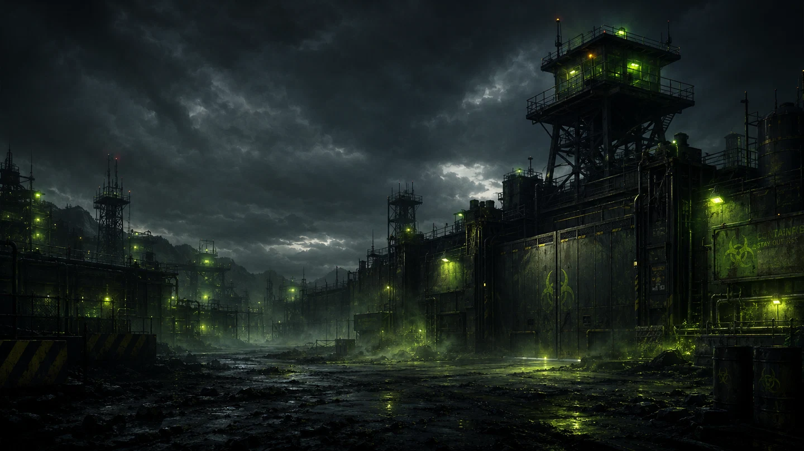

  

<h1 align="center">HAZRD</h1>

<b>CONNECTED WORLDS. SHARED SURVIVAL.</b>

  A network of survival & sandbox game communities — built on shared tooling, one visual identity and one standard for quality.

  
  

---

### ☢️ The network

| Game | Status |
| --- | --- |
| **7 Days to Die** | 🟢 Live — [7days.hazrd.net](https://7days.hazrd.net) |
| **Palworld** | 🟡 Next up |
| Project Zomboid · Rust · ARK · Valheim | ⚪ On the roadmap |

---

### 🛠️ What we build

- **Network site** — the home of HAZRD: games, server status, community and events
- **Game dashboards** — per-game web apps for players: maps, inventory, auctions, shop, leaderboards, wiki
- **Game bridges** — connectors between game servers and the web platform (WebAPI, RCON, Telnet, mods)
- **Discord as code** — a bot that generates and maintains roles, channels and game spaces from a single config
- **Observer** — uptime, economy and ops monitoring for every server in the network

**Stack:** TypeScript · Next.js · Node.js · Discord.js · Docker · self-hosted infrastructure

---

### 🔒 Why is everything private?

Our platform code runs live game economies — so it stays closed. This page is the public front door.
Questions, partnerships or server ideas? → **[hazrd.net](https://hazrd.net)**

Dangerous brand. Trustworthy product. · Built by <a href="https://github.com/mixu-94">@mixu-94</a>

